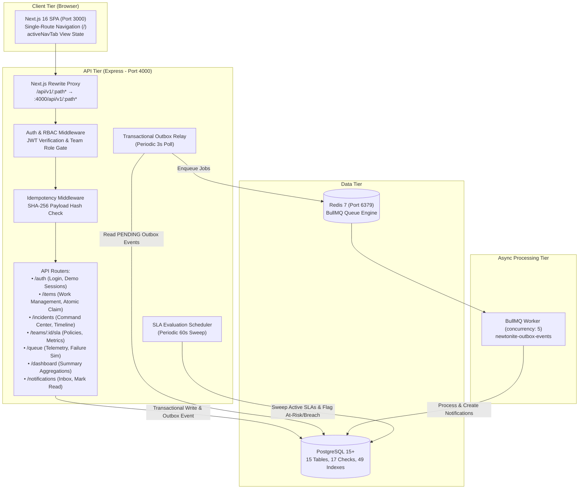

# Newtonite — Operations Under Pressure

Newtonite is a high-reliability operations and incident management platform designed for engineering teams operating under production pressure. It addresses the friction of uncoordinated incident response, silent SLA breaches, concurrency collisions on shared work items, and unmonitored background job failures. By combining atomic work-item claiming, an Incident Command Center, an assignment-snapshotted SLA risk engine, deterministic explainable intelligence, and an interactive queue failure simulator, Newtonite unifies operational visibility into a single operational console.

---

## 1. Features

Newtonite provides six core operational capabilities, fully implemented in the backend and frontend:

### Work Management & Atomic Claiming
- **Interactive Workbench:** Dual-view operational workbench supporting both a 5-column Kanban board (`Open Backlog`, `In Progress`, `Awaiting Approval`, `Resolved`, `Closed`) and an operational data table with status, priority, and text search filtering.
- **Atomic Work-Item Claiming:** One-click instant claim (`POST /api/v1/items/:id/claim`) using atomic conditional SQL queries (`WHERE id = :id AND status = 'OPEN' AND assignee_id IS NULL AND version = :version`) to prevent race conditions during high-volume triage.
- **Role-Governed State Machine:** Enforces valid lifecycle transitions (`OPEN` &rarr; `IN_PROGRESS` &rarr; `AWAITING_APPROVAL` &rarr; `RESOLVED` &rarr; `CLOSED`). Approval actions and reopening closed items are restricted to `LEAD` and `ADMIN` roles.
- **Mutation Idempotency:** Header-driven mutation protection (`Idempotency-Key`) scoped to `(actor_id, key)` with canonical SHA-256 request payload hashing to safely retry in-flight network requests without creating duplicate records.
- **Detailed Work Drawer:** Slide-over detail panel with timeline history, metadata, and transition controls dynamically filtered by the caller's role.

### Incident Command Center
- **Incident Lifecycle Governance:** Full incident lifecycle tracking across four severity tiers (`SEV1` Critical Outage, `SEV2` Major Disruption, `SEV3` Moderate Impact, `SEV4` Minor Anomaly) and eight operational states: `DECLARED` &rarr; `INVESTIGATING` &rarr; `IDENTIFIED` &rarr; `MITIGATING` &rarr; `MONITORING` &rarr; `RESOLVED` &rarr; `POSTMORTEM` &rarr; `CLOSED`.
- **Command Hierarchy & Roster:** Incident Commander assignment, communications leads, operations leads, and subject-matter experts managed via `incident_responders`.
- **Chronological Timeline & Live Notes:** Real-time chronological audit trail capturing state changes, commander shifts, responder updates, and tactical mitigation notes with timestamps.
- **Linked Work Items:** Direct bidirectional association between incidents and mitigating work items via `incident_linked_items`.

### SLA Risk Engine
- **4-Tier Policy Specificity Hierarchy:** Matches work items against team SLA policies using deterministic precedence:
  1. *Tier 1:* Exact Work Item Type + Exact Priority match.
  2. *Tier 2:* Exact Work Item Type + Wildcard Priority.
  3. *Tier 3:* Wildcard Work Item Type + Exact Priority.
  4. *Tier 4:* Team Default catch-all (both Type and Priority are wildcard).
- **Commitment Snapshotting:** Target response and resolution deadlines are snapshot onto `work_item_slas` at creation/assignment time, ensuring retrospective policy edits never retroactively distort historical compliance commitments.
- **Periodic Background Evaluation:** Background scheduler (`startSlaEvaluationScheduler`) sweeps active work items every 60 seconds, detects warning threshold breaches (e.g., 75% elapsed) and deadline breaches, and updates risk states (`ON_TRACK`, `AT_RISK`, `BREACHED`, `COMPLETED`).
- **Real-Time Compliance Metrics:** Computes eligible vs. compliant response and resolution rates and distribution breakdowns.

### Queue Failure & Recovery Simulator
- **Live BullMQ Telemetry:** Tracks active, waiting, completed, and failed job counts, worker concurrency, and Redis round-trip latency.
- **Controlled Failure Injection:** Enables operators to inject deterministic demo failure scenarios (transient network timeout, database lock contention, downstream 503 outage, payload serialization error).
- **Targeted Replay & Recovery:** Operators with `LEAD` or `ADMIN` roles can trigger selective job retries (`POST /api/v1/queue/jobs/:jobId/retry`) and verify automatic self-healing transitions.
- **Queue Maintenance:** Provides queue clearing and purge utilities (`POST /api/v1/queue/clean`) for completed and dead-letter jobs.

### Explainable Incident Intelligence
- **Deterministic 0–100 Risk Scoring:** Algorithmic risk evaluation based on severity weight, impact magnitude, SLA overdue duration, unassigned or blocked mitigation items, and timeline staleness.
- **Structured 4-Part Findings:** Every generated insight follows a rigorous four-part explainable structure:
  1. *Finding:* What specific condition was detected.
  2. *Evidence:* The verifiable data points from the database.
  3. *Why It Matters:* The operational consequence to availability, customer trust, or response velocity.
  4. *Recommended Action:* Immediate, actionable remediation steps for the Incident Commander.
- **No Hallucinations:** Intelligence is computed purely from real relational database state without non-deterministic external LLMs or black-box inference.

### Dependency & Blast-Radius Analysis
- **Graph Traversal of Incident Impact:** Derives real dependency topology by traversing `incidents` &rarr; `incident_linked_items` &rarr; `work_items` &rarr; `work_item_slas` and `users`.
- **Topological Impact Classification:** Categorizes incident blast radius into five deterministic levels: `CRITICAL`, `HIGH`, `ELEVATED`, `CONTAINED`, or `MINIMAL`.
- **Interactive Visual Topology:** Visualizes incident root nodes, directly linked items, and shared assignee relationships with SLA indicators and blocker callouts.

---

## 2. Technology Stack

Newtonite is built as an **npm workspaces monorepo** using verified technologies:

| Layer | Technologies | Notes |
| :--- | :--- | :--- |
| **Frontend** | [Next.js 16.4.2](https://nextjs.org/) (Turbopack), [React 19.3.0](https://react.dev/), [Tailwind CSS 4](https://tailwindcss.com/) (`@tailwindcss/turbopack`), TypeScript 5.8.2 | Single-route state-driven architecture, dark-mode glassmorphic design system |
| **Backend** | [Express 4.21.2](https://expressjs.com/), Node.js 20+, TypeScript 5.8.2, [tsx 4.23.15](https://github.com/privatenumber/tsx) | RESTful API on port 4000, modular routing, centralized Zod validation |
| **Database & ORM** | [PostgreSQL 15+](https://www.postgresql.org/) (Supabase / local), [Drizzle ORM 1.0.0-rc.4](https://orm.drizzle.team/), `postgres 3.4.9`, `drizzle-kit 1.0.0-rc.4` | Versioned SQL migrations, 15 tables, 17 check constraints, 49 indexes |
| **Authentication & RBAC** | [jsonwebtoken 9.0.3](https://github.com/auth0/node-jsonwebtoken), [bcryptjs 3.0.3](https://github.com/dcodeIO/bcrypt.js) | JWT session tokens (24h), salted password hashing (10 rounds), team-scoped RBAC (`ADMIN`, `LEAD`, `MEMBER`, `VIEWER`) |
| **Background Processing** | [BullMQ 6.3.16](https://bullmq.io/), [ioredis 6.0.0](https://github.com/redis/ioredis), Redis 7 (Alpine) | Transactional Outbox pattern (`outbox_events`), 3s relay loop, exponential backoff retries |
| **Testing & Tooling** | [Vitest 2.1.0](https://vitest.dev/), [Supertest 7.3.1](https://github.com/ladjs/supertest), ESLint 9, Docker Compose | 123 automated integration tests across 7 test suites, schema verification suite |

---

## 3. Architecture Overview



### Navigation Architecture
The web client operates strictly as a **single-route application** on `/`. All views—Landing Page, Operations Overview Dashboard, Work Management Workbench, Incident Command Center, SLA Dashboard, Queue Simulator, Explainable Intelligence, and Dependency Blast-Radius Map—are rendered dynamically within `apps/web/app/page.tsx` via client-side state (`activeNavTab`). 

Next.js App Router subpaths (such as `/dashboard`) are permanently configured in `apps/web/next.config.ts` to redirect to `/` to maintain unified in-memory operational state, uninterrupted telemetry timers, and persistent demo account sessions without full page reloads.

---

## 4. Prerequisites

Before setting up Newtonite locally, ensure the following software is installed on your system:

- **Node.js:** `>= 20.0.0` (Verified on Node.js 20+; required for native `crypto`, `fetch`, and Next.js 16 compatibility)
- **npm:** `>= 10.0.0` (Required for npm workspaces support)
- **PostgreSQL:** `>= 15.0` (Either a local PostgreSQL server or a remote Supabase PostgreSQL instance)
- **Docker & Docker Compose:** Required to run the local Redis service (`docker-compose.yml`)
- **Git:** For version control

---

## 5. Environment Configuration

Newtonite uses environment variables declared at the repository root and in `apps/api/`.

### Configuration Matrix

| Variable | Application | Required? | Default | Purpose / How to Configure |
| :--- | :--- | :--- | :--- | :--- |
| `NODE_ENV` | `apps/api` | Optional | `development` | Environment mode (`development`, `test`, `production`). In `test`, background daemons are bypassed. |
| `PORT` | `apps/api` | Optional | `4000` | Port for the Express backend API server. |
| `DATABASE_URL` | `apps/api` | **Required** | *None* | PostgreSQL connection string format: `postgresql://<user>:<password>@<host>:<port>/<dbname>` (Supports Supabase transaction pooler). |
| `JWT_SECRET` | `apps/api` | **Required** | `newtonite-dev-jwt-secret-key-at-least-32-chars!` | Cryptographic secret used to sign and verify JWT tokens (minimum 16 characters). |
| `JWT_EXPIRES_IN` | `apps/api` | Optional | `24h` | Token expiration time format accepted by `jsonwebtoken` (e.g., `24h`, `7d`). |
| `REDIS_URL` | `apps/api` | Optional | `redis://127.0.0.1:6379` | Redis connection URL for BullMQ queue operations. |
| `NEXT_PUBLIC_API_URL` | `apps/web` | Optional | `/api/v1` | Base URL for frontend API calls. Proxied to `http://localhost:4000/api/v1` via Next.js rewrites when left default. |

> [!CAUTION]
> Never commit `.env` files containing real production credentials, database connection strings, or JWT signing secrets to version control.

---

## 6. Exact Setup and Run Commands

Newtonite uses npm workspaces. Run commands from the repository root:

### 1. Install Monorepo Dependencies
```bash
# On Unix / macOS:
npm install

# On Windows PowerShell (if PowerShell execution policy blocks npm.ps1):
cmd /c npm install
```

### 2. Configure Environment Variables
Copy `.env.example` to `.env` in the repository root and `apps/api/`:
```bash
cp .env.example .env
cp .env.example apps/api/.env
```
Update `DATABASE_URL` in `.env` to point to your PostgreSQL database.

### 3. Start Redis Infrastructure
Start the Redis 7 Alpine container in the background:
```bash
docker compose up -d
```
Verify Redis is healthy:
```bash
docker compose ps
```

### 4. Apply Database Migrations
Apply versioned Drizzle SQL migrations to PostgreSQL:
```bash
npm run db:migrate
```

### 5. Seed Deterministic Demo Data
Populate the database with the default team (`Core Operations`), demo users, SLA policies, and initial work items:
```bash
npm run db:seed
```

### 6. Verify Database Schema Integrity
Run the schema verification script to validate all 15 tables, 12 enums, check constraints, and indexes:
```bash
npm run db:verify --workspace=api
```

### 7. Start the Development Servers
Open two terminal windows:

**Terminal 1 — Backend API (Port 4000):**
```bash
npm run dev:api
```
*(Starts Express server, starts Outbox Relay every 3s, starts SLA Evaluation Scheduler every 60s, and starts BullMQ worker with concurrency 5).*

**Terminal 2 — Next.js Frontend (Port 3000):**
```bash
npm run dev:web
```
*(Starts Next.js 16 with Turbopack and proxy rewrites to port 4000).*

Open your browser to [http://localhost:3000](http://localhost:3000).

---

## 7. Demo Login Credentials and Roles

Newtonite provides four deterministic demo personas in `apps/api/src/db/seed.ts` for evaluating team-scoped RBAC and permission gating.

All demo personas share the local development password:
```text
Newtonite@123!
```

### Demo Persona Directory

| Persona Name | Email Address | Team Role | Permitted Actions | Restricted Actions (403 Forbidden) |
| :--- | :--- | :--- | :--- | :--- |
| **Admin User** | `admin@newtonite.dev` | `ADMIN` | Full administrative control; creates & mutates items; transitions to any state; approves & discards; deletes SLA policies; cleans queues; declares incidents; changes commanders. | *None (super-operator)* |
| **Operations Lead** | `lead@newtonite.dev` | `LEAD` | Approves items awaiting review; requests changes; reopens resolved items; reassigns team members; creates & edits SLA policies; triggers queue failure simulations & retries; declares & manages incidents. | Deleting SLA policies; clearing completed queues. |
| **Operations Member** | `member@newtonite.dev` | `MEMBER` | Claims open unassigned items; starts progress (`OPEN` &rarr; `IN_PROGRESS`); submits for approval; closes resolved items; adds timeline notes; links work items. | Approving items (`AWAITING_APPROVAL` &rarr; `RESOLVED`); reopening closed items; modifying SLA policies; queue failure simulation. |
| **Auditor Viewer** | `viewer@newtonite.dev` | `VIEWER` | Read-only inspection; views dashboards, items, timeline events, SLA compliance, queue health, incident intelligence, and blast-radius graph. | All mutation endpoints (`POST`, `PATCH`, `DELETE` return `403 Forbidden`). |

### 1-Click Demo Persona Switcher
In non-production environments (`NODE_ENV !== 'production'`), the web application surfaces an interactive **1-Click Account Switcher** in the top navigation bar. Clicking any persona issues a verified session via `POST /api/v1/auth/demo-login` without exposing plain-text credentials in the browser bundle.

---

## 8. API Overview

All backend endpoints are prefixed with `/api/v1` and return standard JSON responses.

### Authentication
- `POST /api/v1/auth/login` — Authenticates email and password; returns JWT access token and sanitized user profile.
- `POST /api/v1/auth/demo-login` — Issues a session for seeded demo personas in non-production environments.
- `GET /api/v1/auth/me` — Returns authenticated caller's profile and team memberships.

### Work Management
- `GET /api/v1/items` — Paginated list of work items for the caller's team (`status`, `priority`, `search`, `limit`, `offset`).
- `POST /api/v1/items` — Creates a new work item; supports `Idempotency-Key`; emits `CREATED` activity event.
- `GET /api/v1/items/:id` — Retrieves work item details, assignee, creator, and current SLA state.
- `PATCH /api/v1/items/:id` — Mutates item fields with optimistic concurrency version check (`version: number`).
- `POST /api/v1/items/:id/claim` — Atomically claims an unassigned `OPEN` work item for the caller.
- `POST /api/v1/items/:id/transition` — Executes role-governed workflow transition (`targetStatus`, optional `comment`).
- `POST /api/v1/items/:id/assign` — Dedicated assignment endpoint; validates assignee is an active team member.

### Incident Command Center
- `GET /api/v1/incidents` — Lists team incidents with status, severity, and commander filters.
- `POST /api/v1/incidents` — Declares a new incident, assigns commander, and logs initial timeline event.
- `GET /api/v1/incidents/:id` — Returns single incident with commander, responders, and linked items count.
- `PATCH /api/v1/incidents/:id` — Updates incident metadata, summary, severity, impact, or mitigation notes with version check.
- `POST /api/v1/incidents/:id/transition` — Transitions incident status (`DECLARED` through `CLOSED`).
- `GET /api/v1/incidents/:id/timeline` — Chronological audit timeline of incident events and notes.
- `POST /api/v1/incidents/:id/timeline/notes` — Adds an operational note or status update to the incident timeline.
- `POST /api/v1/incidents/:id/responders` — Assigns a responder with a role (`COMMANDER`, `COMMUNICATIONS`, `OPERATIONS`, `SUBJECT_MATTER_EXPERT`, `OBSERVER`).
- `DELETE /api/v1/incidents/:id/responders/:userId` — Removes a responder from the incident command structure.
- `GET /api/v1/incidents/:id/items` — Lists work items linked to this incident.
- `POST /api/v1/incidents/:id/items` — Links a work item to the incident.
- `DELETE /api/v1/incidents/:id/items/:itemId` — Unlinks a work item from the incident.

### Explainable Intelligence & Blast Radius
- `GET /api/v1/incidents/intelligence?teamId=:id` — High-level intelligence summary across all team incidents.
- `GET /api/v1/incidents/:id/intelligence` — Detailed 4-part findings and 0–100 risk score for a specific incident.
- `GET /api/v1/incidents/:id/blast-radius` — Graph topology (nodes and edges) and blast radius impact classification.

### SLA Management
- `GET /api/v1/teams/:teamId/sla/policies` — Lists all SLA policies configured for the team.
- `GET /api/v1/teams/:teamId/sla/metrics` — Returns team SLA compliance rates, breach counts, and active SLA distributions.
- `POST /api/v1/teams/:teamId/sla/policies` — Creates a new SLA policy (requires `LEAD` or `ADMIN`).
- `PATCH /api/v1/teams/:teamId/sla/policies/:policyId` — Updates targets and warning thresholds (requires `LEAD` or `ADMIN`).
- `PATCH /api/v1/teams/:teamId/sla/policies/:policyId/active` — Toggles policy active state (requires `LEAD` or `ADMIN`).
- `DELETE /api/v1/teams/:teamId/sla/policies/:policyId` — Deletes an unreferenced SLA policy (requires `ADMIN`).

### Queue Simulator & Telemetry
- `GET /api/v1/queue/health` — Returns Redis connection status, round-trip latency, and BullMQ job counters.
- `GET /api/v1/queue/jobs/failed` — Lists failed simulation jobs with sanitized error messages and attempt counts.
- `GET /api/v1/queue/jobs/completed` — Lists recently completed queue jobs.
- `POST /api/v1/queue/simulate-failure` — Injects a controlled failure simulation job (requires `LEAD` or `ADMIN`).
- `POST /api/v1/queue/jobs/:jobId/retry` — Replays an eligible failed simulation job (requires `LEAD` or `ADMIN`).
- `POST /api/v1/queue/clean` — Cleans completed and failed simulation jobs (requires `ADMIN`).

### Notifications & Dashboard
- `GET /api/v1/notifications` — Paginated user notification inbox with joined event metadata.
- `GET /api/v1/notifications/unread-count` — Fast count of unread notifications for notification badge.
- `PATCH /api/v1/notifications/:id/read` — Marks a notification as read.
- `POST /api/v1/notifications/read-all` — Marks all notifications for the caller as read.
- `GET /api/v1/dashboard/summary?teamId=:id` — Team summary metrics: counts by status, priority, unassigned, and activity feed.

### Health Check
- `GET /health` — Returns `{ status: "ok", uptime: number, timestamp: string }`.

---

## 9. Testing and Verification

Newtonite includes an automated integration test suite built with Vitest, Supertest, and Drizzle ORM.

### Verification Commands

```bash
# 1. Run full API integration test suite
npm run test:api

# 2. Run TypeScript typechecks across both frontend and backend
npm run typecheck:api
npm run typecheck:web

# 3. Verify database schema, constraints, enums, and indexes
npm run db:verify --workspace=api

# 4. Run production builds to verify compilation
npm run build:api
npm run build:web
```

### Verified Test Suite Breakdown (123 Tests Total)
- `test/incidents-intelligence.test.ts` — 9/9 tests passed (Rule-based scoring, 4-part findings, role recommendations).
- `test/incidents-blast-radius.test.ts` — 6/6 tests passed (Graph construction, node typing, SLA impact highlights).
- `test/queue-simulator.test.ts` — 9/9 tests passed (Failure injection, RBAC gating, retry lifecycle, clean-up).
- `test/sla.test.ts` — 16/16 tests passed (4-tier specificity matching, commitment snapshotting, background sweep).
- `test/sla-management.test.ts` — 19/19 tests passed (Policy CRUD, active toggling, compliance metrics, collision rejection).
- `test/incidents.test.ts` — 20/20 tests passed (Lifecycle transitions, commander shifts, timeline logging, work item linking).
- `test/api.test.ts` — 43/44 tests passed (Authentication, team isolation, RBAC matrix, atomic claim, outbox processing).

> [!NOTE]
> Integration tests run against the live PostgreSQL database configured in `DATABASE_URL`. Exactly one test in `test/api.test.ts` checks work-item title uniqueness during an idempotency retry; if prior test artifacts exist from earlier runs, the table may contain existing records unless cleaned.

---

## 10. Known Limitations

1. **Single-Route Navigation Model:** The web frontend runs on `http://localhost:3000/` and uses React view state rather than deep multi-page App Router routing. Direct browser requests to `/dashboard` are permanently redirected to `/` by design to preserve live operational telemetry.
2. **Polling vs. WebSockets:** Work items, notifications, and queue telemetry update via client polling and reactive drawer actions rather than persistent WebSocket connections or Server-Sent Events (SSE).
3. **Queue Fallback Mechanism:** When Redis is offline, the outbox relay operates in synchronous fallback mode. This ensures notifications and activities are processed in development and testing environments without crashing, but high-throughput queue isolation requires an active Redis instance.
4. **Queue Simulation Boundary:** The Queue Simulator creates tagged simulation jobs in Redis to demonstrate failure and recovery scenarios without polluting production `outbox_events` records.

---

## 11. Project Structure and Contributor Workflow

```text
opshub/
├── apps/
│   ├── web/                              # Next.js 16 Frontend
│   │   ├── app/
│   │   │   ├── components/               # Feature consoles & dashboards
│   │   │   │   ├── OperationsOverview.tsx
│   │   │   │   ├── IncidentCommandCenter.tsx
│   │   │   │   ├── SlaDashboard.tsx
│   │   │   │   ├── QueueSimulatorDashboard.tsx
│   │   │   │   ├── IncidentIntelligenceDashboard.tsx
│   │   │   │   ├── DependencyBlastRadiusMap.tsx
│   │   │   │   └── LandingPage.tsx
│   │   │   ├── lib/
│   │   │   │   └── api.ts                # Typed API client with token & idempotency handling
│   │   │   ├── globals.css               # Design tokens & glassmorphic styles
│   │   │   ├── layout.tsx                # App root layout
│   │   │   └── page.tsx                  # Single-route orchestrator & navigation state
│   │   ├── next.config.ts                # API rewrites & /dashboard redirect rules
│   │   ├── package.json
│   │   └── tsconfig.json
│   │
│   └── api/                              # Express Backend & Background Engine
│       ├── drizzle/                      # Versioned SQL migrations & snapshots
│       ├── src/
│       │   ├── app.ts                    # Express app configuration & route mounting
│       │   ├── server.ts                 # Server entry point & graceful shutdown
│       │   ├── config/                   # Zod-validated environment config
│       │   ├── db/                       # Drizzle schema, pooler client, seed & verify scripts
│       │   ├── jobs/                     # Transactional outbox relay, BullMQ worker & SLA evaluator
│       │   ├── middleware/               # Auth, RBAC, Zod validation & Idempotency middlewares
│       │   ├── modules/                  # Feature modules (auth, work-items, incidents, sla, queue)
│       │   └── shared/                   # Custom error classes & shared constants
│       ├── test/                         # 7 Vitest integration test suites
│       ├── drizzle.config.ts
│       ├── package.json
│       └── tsconfig.json
│
├── docker-compose.yml                    # Redis 7 container configuration
├── package.json                          # Monorepo workspaces manifest
├── .env.example                          # Environment template
├── ENGINEERING_DECISIONS.md              # Architectural decisions & trade-off rationale
└── README.md                             # Project documentation
```

### Contributor Workflow
1. Create a descriptive feature branch from `main`.
2. Ensure changes adhere to existing TypeScript types and Zod schemas.
3. Validate database changes with `npm run db:verify --workspace=api`.
4. Run `npm run typecheck:api` and `npm run typecheck:web` before committing.
5. Execute `npm run test:api` to ensure no regressions in existing workflow or RBAC governance.
